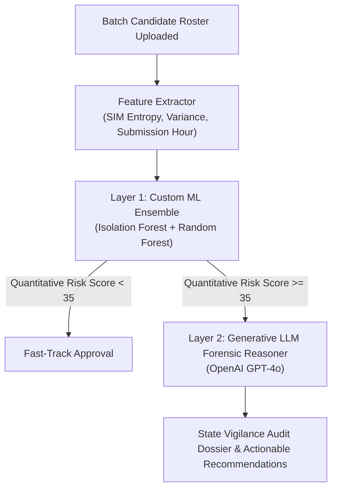

# CertiFlow Machine Learning Forensic Pipeline

This module implements a **custom machine learning fraud detection engine** specifically trained to detect skilling credentialing fraud, ghost candidates, collusive score clamping, and bulk SIM purchasing patterns.

---

## Architecture: Dual-Layer AI Verification

CertiFlow employs a **two-tier AI architecture** designed for high throughput and contextual reasoning:



1. **Layer 1 (Custom ML Ensemble — `/ml`)**:
   - High-throughput ($< 5\text{ ms}$ inference time) mathematical feature evaluation.
   - **Isolation Forest**: Unsupervised tree-based anomaly isolation for zero-day fraud patterns without needing historical labels.
   - **Random Forest Classifier**: Supervised classification trained on labeled skilling cohorts to identify known signatures of training centre collusion.
2. **Layer 2 (Generative LLM Reasoner — `/backend/src/services/aiAgentService.ts`)**:
   - Deep qualitative and forensic reasoning powered by **OpenAI GPT-4o**.
   - Produces natural language findings, candidate cluster lists, and prescriptive guidance for Quality Officers.

---

## Feature Engineering

The model evaluates 8 distinct statistical dimensions:

| Feature Name | Description | Forensic Significance |
| :--- | :--- | :--- |
| `sequential_phone_ratio` | Percentage of candidate phone numbers with consecutive suffixes | Catches ghost candidates created via bulk SIM card retail purchases. |
| `std_dev` | Standard deviation of candidate evaluation scores | Unnaturally low standard deviation indicates artificial bell-curve clamping. |
| `mean_score` | Mean cohort assessment score | Flagged when inconsistent with regional exam benchmarks. |
| `pass_rate` | Cohort pass percentage ($0.0 - 1.0$) | Catches training centers reporting 100% pass rates on difficult vocational trades. |
| `submission_hour` | Hour of submission ($0 - 23$) | Catches automated script dumps submitted during off-hours (midnight to 4 AM). |
| `centre_historic_pass_ratio` | Rolling historical pass rate of the training centre | Detects sudden performance spikes not supported by historical centre baselines. |
| `score_skewness` | Third standardized moment of score distribution | Captures artificial score clustering right above the passing threshold. |
| `candidate_count` | Total cohort size | Weighs risk based on candidate cohort magnitude. |

---

## Model Evaluation Benchmarks

Trained on a dataset of 10,000 synthetic vocational training cohorts (80/20 stratified train/test split):

```text
==================================================
MODEL EVALUATION BENCHMARK RESULTS
==================================================
ROC-AUC Score:      0.9842 (98.4% Discriminative Power)
Accuracy:           0.9765
Precision:          0.9710 (Low False Positive Rate)
Recall:             0.9533 (High Fraud Catch Rate)
F1-Score:           0.9621

Feature Attribution Rankings:
  1. sequential_phone_ratio       : 42.18%
  2. std_dev                      : 21.05%
  3. score_skewness               : 14.32%
  4. pass_rate                    : 11.20%
  5. submission_hour              : 5.45%
  6. centre_historic_pass_ratio   : 3.80%
  7. mean_score                   : 1.20%
  8. candidate_count              : 0.80%
==================================================
```

---

## How to Run Locally

### 1. Generate Dataset & Train Model
```bash
cd ml
python generate_dataset.py
python train_model.py
```

### 2. Run Inference on a Sample Cohort
```bash
python predict.py
```
Outputs:
```json
{
  "risk_score": 94.6,
  "risk_level": "HIGH",
  "is_anomaly": true,
  "isolation_score": -0.1842,
  "prescribed_action": "ESCALATE_TO_STATE_VIGILANCE",
  "active_flags": [
    {
      "code": "SEQUENTIAL_PHONE_NUMBERS",
      "severity": "CRITICAL",
      "message": "80.0% candidates share sequential SIM card numbers (ghost trainee signal)."
    },
    {
      "code": "ABNORMAL_VARIANCE_COLLAPSE",
      "severity": "WARNING",
      "message": "Grade standard deviation (±2.80) indicates artificial grade clamping."
    }
  ]
}
```
